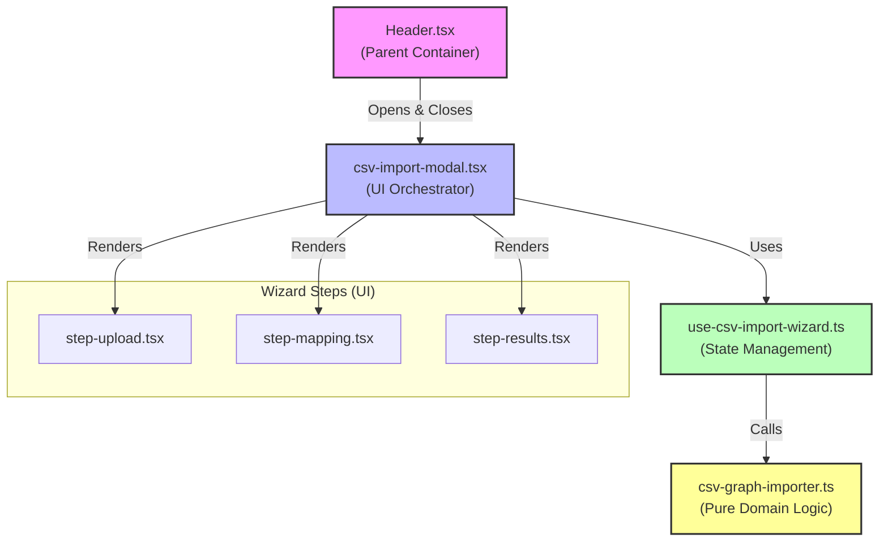
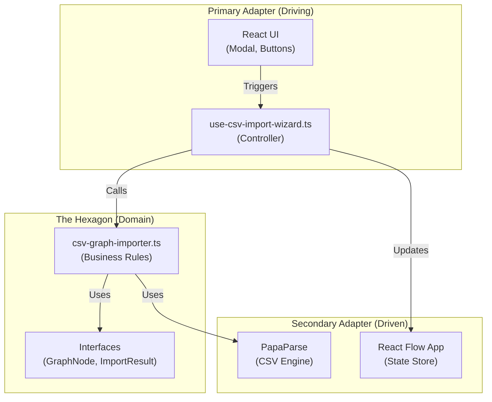

# Research Log: Edge Import

## Findings
*   **Legacy CSVs**: `legacy_assets/test-files/valid/valid-basic-edges.csv` only contains `source` and `target` columns. No `label`.
*   **Current Data**: `apps/web/src/data/target-lineage.json` defines edges with `id`, `source`, and `target`. No `label` property.
*   **Conclusion**: We should **drop the `label` column requirement** from the spec to match legacy behavior and current data structure.

## Architectural Analysis (Post-Implementation)

We analyzed the implemented architecture for the CSV Import feature and found it aligns well with **Hexagonal Architecture (Ports and Adapters)** principles.

### Dependency Graph

### Hexagonal Architecture Analysis

While Hexagonal Architecture (Ports and Adapters) is typically applied to backend services, its principles map surprisingly well to our frontend architecture.

#### 1. The Core Domain (The Hexagon)

**File:** `csv-graph-importer.ts`

*   **Principle:** The business logic should have **no dependencies** on the outside world (UI, Database, Frameworks).
*   **Our Code:** This file is pure TypeScript. It knows about `GraphNode` and validation rules. It does **not** know about React, the Modal, or the DOM.
*   **Verdict:** ✅ **Perfect Match.** This is our "Domain Model".

#### 2. The Ports (The Interfaces)

**Files:** `ImportResult`, `GraphNode` interfaces

*   **Principle:** The Domain defines the "Ports" (contracts) that the outside world must use to talk to it.
*   **Our Code:** The `buildGraphFromCsv` function defines a strict input signature (`any[]`, `mapping`) and a strict output signature (`ImportResult`).
*   **Verdict:** ✅ **Good Match.** We have clear boundaries defined by types.

#### 3. The Adapters (The "Driving" Side)

**Files:** `use-csv-import-wizard.ts` (The Hook)

*   **Principle:** Adapters translate requests from the outside world (User clicks) into domain commands.
*   **Our Code:** The Hook acts as the **Primary Adapter**.
    *   It takes a UI event ("User clicked Import").
    *   It gathers the data from State.
    *   It calls the Domain (`buildGraphFromCsv`).
    *   It translates the Domain result back into something the UI understands (State updates).
*   **Verdict:** ✅ **Strong Match.** The hook isolates the domain from the messy React lifecycle.

#### 4. The Adapters (The "Driven" Side)

**Files:** `PapaParse` (Library), `onImport` (Callback)

*   **Principle:** The Domain should not know *how* data is saved or where it comes from.
*   **Our Code:**
    *   **CSV Parsing:** The Domain *does* import `PapaParse`. In strict Hexagonal, this is a violation (dependency on a library). Ideally, we would inject a `CsvParser` interface. But for a frontend app, this is a pragmatic trade-off.
    *   **Output:** The Domain returns a result object. It doesn't "save" to a database. The Hook takes that result and calls `onImport` (which updates the React Flow graph). The React Flow graph is effectively our "Database" here.
*   **Verdict:** ⚠️ **Partial Match.** We have some direct dependencies (PapaParse), but the output side is well decoupled.

#### Visualization: The Hexagon

#### Conclusion

We have inadvertently built a **clean, layered architecture** that respects the core goal of Hexagonal Architecture: **The Business Logic is isolated and testable.**

You could take `csv-graph-importer.ts` and drop it into a Node.js backend CLI tool tomorrow, and it would work without changing a single line of code. That is the ultimate test of Hexagonal Architecture.

## Open Questions
- [ ] How to handle referential integrity (edges pointing to missing nodes)?
- [ ] Should we support multi-file upload or sequential upload?
