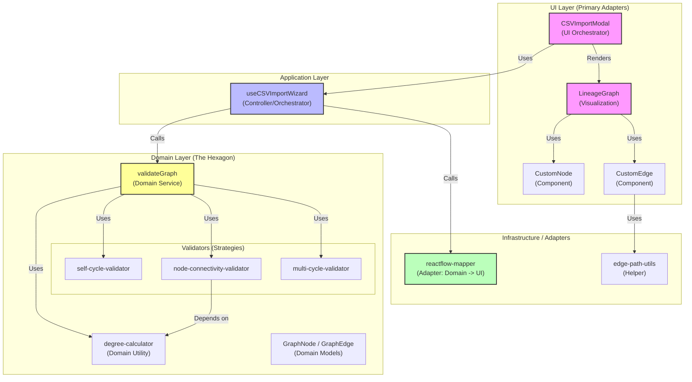

# Architectural Review: Graph Validation

## Overview
This document analyzes the architecture of the Graph Validation feature following the refactoring. It includes a dependency graph and a critique based on Hexagonal Architecture principles.

## Dependency Graph

The following diagram illustrates the relationships between the UI components, the integration hook, the domain logic, and the adapters.

## Hexagonal Architecture Critique

The refactored architecture aligns strongly with **Hexagonal Architecture (Ports and Adapters)** principles.

### 1. The Core Domain (The Hexagon)
*   **Files**: `graph-validation.ts`, `degree-calculator.ts`, and the validator files.
*   **Analysis**: These files are pure TypeScript. They operate exclusively on `GraphNode` and `GraphEdge` domain models. They have **zero dependencies** on React, ReactFlow, or the DOM.
*   **Verdict**: ✅ **Perfect Isolation.** The business rules for validation are completely decoupled from the visualization technology.

### 2. The Primary Adapter (Driving Side)
*   **File**: `useCSVImportWizard.ts`
*   **Analysis**: This hook acts as the controller. It receives user input (file upload, mapping confirmation) and "drives" the domain logic. It calls `validateGraph` to get a domain result.
*   **Verdict**: ✅ **Clear Separation.** The hook orchestrates the flow but delegates the actual "thinking" to the domain layer.

### 3. The Secondary Adapter (Driven Side)
*   **File**: `reactflow-mapper.ts`
*   **Analysis**: This is a classic "Anti-Corruption Layer" or Adapter. The Domain returns a pure validation result (`Map<string, string[]>`). The UI needs `ReactFlow.Node` objects with specific `data` properties. The mapper translates between these two worlds.
*   **Verdict**: ✅ **Strong Decoupling.** If we decided to switch from ReactFlow to D3.js or Cytoscape tomorrow, we would only need to write a new `d3-mapper.ts`. The domain logic (`validateGraph`) would remain 100% unchanged.

### 4. Visualization Components
*   **Files**: `CustomNode.tsx`, `CustomEdge.tsx`
*   **Analysis**: These components are "dumb" in the best way. They don't calculate validation rules; they just render what they are told. `CustomEdge` encapsulates the complexity of *drawing* (geometry), but not the complexity of *business rules*.
*   **Verdict**: ✅ **Single Responsibility.** The UI focuses on presentation, while the Domain focuses on correctness.

## Conclusion
The refactoring has successfully transformed a monolithic implementation into a modular, layered architecture. The clear separation between **Domain Logic** (Validation) and **Infrastructure** (ReactFlow Visualization) ensures that the system is testable, maintainable, and adaptable to future changes.
