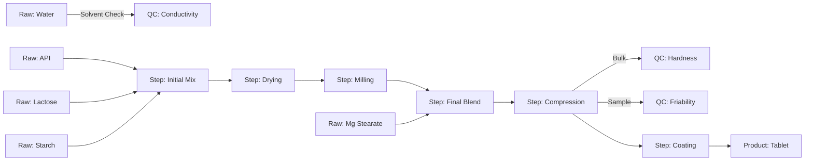

# Domain Exploration: Chemical Processing

## Concept
Trace the production of a pharmaceutical tablet (e.g., "PainRelief Maximum").
**Context**: Quality Assurance needs to trace a batch of failed tablets back to specific raw material batches or processing anomalies.

## Entities
### 1. Raw Materials (Inputs)
*   **Active Pharmaceutical Ingredient (API)**: `Ibuprofen_Batch_99X`
*   **Excipients**: `Microcrystalline_Cellulose`, `Magnesium_Stearate`, `Silicon_Dioxide`.
*   **Properties**:
    *   `Purity`: 99.8%
    *   `Supplier`: "PharmaCorp"
    *   `Expiry`: "2026-12-01"

### 2. Processing Steps (Transformations)
*   **Wet Granulation**: Mixing API with binders.
    *   *Properties*: `Granule_Size_Distribution`, `Moisture_Content`.
*   **Drying**: Removing solvent.
    *   *Properties*: `Outlet_Temp`, `Duration_Minutes`.
*   **Compression**: Pressing granules into tablets.
    *   *Properties*: `Compression_Force_kN`, `Tablet_Hardness`.
*   **Coating**: Adding the outer layer.
    *   *Properties*: `Spray_Rate`, `Inlet_Temp`.

### 3. Quality Control (Outputs)
*   **Final Batch**: `Batch_PR_2025_001`
*   **Test Results**: `Dissolution_Rate_Test`, `Content_Uniformity`.

## Topology & Creative Liberty
**Goal**: Move away from rigid "Input -> Step 1 -> Step 2 -> Output" structures.
**Desired Characteristics**:
1.  **Jagged Layers**: Connections should skip layers (e.g., `Input` -> `Output` directly, or `Input` -> `Layer 3`).
2.  **Emergent Complexity**: The graph should look "grown" rather than "architected".
3.  **Vocabulary Injection**: Use a rich pool of domain terms to generate nodes.

### Vocabulary Pools
*   **Ingredients (Starts)**: `Acetylsalicylic Acid`, `Titanium Dioxide`, `Purified Water`, `Corn Starch`, `Ethanol 96%`, `Lactose Monohydrate`.
*   **Actions (Middle - Verbs)**: `High Shear Mixing`, `Fluid Bed Drying`, `Dry Milling`, `V-Blending`, `Rotary Compression`, `Film Coating`, `Laser Drilling`, `Blister Packing`.
*   **States (Middle - Adjectives)**: `Granulated Bulk`, `Dried Powder`, `Milled Fines`, `Coated Tablet`, `Tablets (Unpolished)`.
*   **Quality Checks (Ends/Taps)**: `Dissolution Profile`, `Karl Fischer Moisture`, `Hardness Limit`, `Friability Test`, `Assay (HPLC)`, `Uniformity of Dosage`.

## Revised Sample Graph (Jagged)

## Potential Issues (Demo Scenarios)
1.  **Cycle**: `Rework_Loop`. Sometimes tablets are crushed and fed back into Granulation.
    *   *Graph*: `Compression` -> `Rework_Grinder` -> `Granulation`.
2.  **Orphan**: `Orphan_API_Barrel`. A barrel of API that was logged but never used in any batch (Missing outgoing edge).
3.  **Properties**: Clicking `Granulation` reveals `Moisture_Content: 12%` (High), explaining why the `Tablet_Hardness` failed later.
