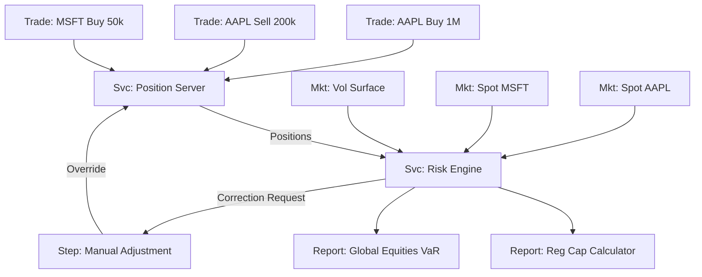

# Domain Exploration: Financial Risk

## Concept
Calculate the **Value at Risk (VaR)** for a Global Equities Desk.
**Context**: A Risk Manager sees an abnormally high risk number and needs to trace it back to a specific "Fat Finger" trade or missing market data.

## Entities
### 1. Trade Data (Inputs)
*   **Trades**: `Trade_AAPL_BUY_1M`, `Trade_MSFT_SELL_500K`.
*   **Market Data**: `FxRate_USD_GBP`, `Vol_Surface_SPX`.
*   **Properties**:
    *   `Notional`: $1,000,000
    *   `Trader`: "J. Doe"
    *   `Counterparty`: "Bank_XYZ"

### 2. Aggregation & Enrichment (Transformations)
*   **Position_Server**: Aggregates trades by ticker.
    *   *Properties*: `Net_Position`, `Avg_Price`.
*   **Risk_Engine**: Applies volatility models to positions.
    *   *Properties*: `Model_Version`: "v2.1", `Confidence_Interval`: "99%".
*   **Reporting_Service**: Aggregates risk numbers into a PDF.

### 3. Reports (Outputs)
*   **Daily_VaR_Report**: The final number showing potential loss.
*   **P&L_Attribution**: Explains *why* we made/lost money.

## Sample Graph (Mermaid)

## Potential Issues (Demo Scenarios)
1.  **Cycle**: `Adjustment_Loop`. Risk Engine outputs a value -> Human rejects it -> Enters Manual Adjustment -> Feeds back into Position Server.
2.  **Orphan**: `Trade_X99`. A trade that was booked but never picked up by the Position Server (Missing edge), leading to under-reported risk.
3.  **Properties**: Risk Engine shows `Model: Legacy_v1` (Deprecated), explaining the calculation error.
