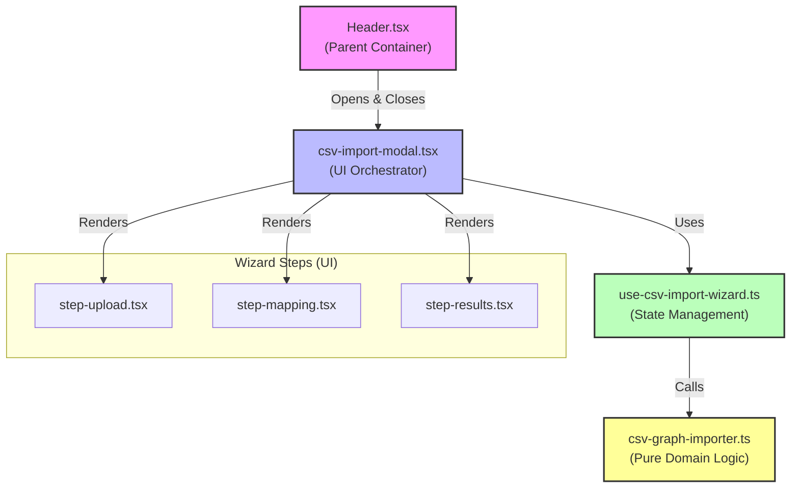

# Research Log: Edge Import

## Findings
*   **Legacy CSVs**: `legacy_assets/test-files/valid/valid-basic-edges.csv` only contains `source` and `target` columns. No `label`.
*   **Current Data**: `apps/web/src/data/target-lineage.json` defines edges with `id`, `source`, and `target`. No `label` property.
*   **Conclusion**: We should **drop the `label` column requirement** from the spec to match legacy behavior and current data structure.

## Architectural Analysis (Post-Implementation)

We analyzed the implemented architecture for the CSV Import feature and found it aligns well with **Hexagonal Architecture (Ports and Adapters)** principles.

### Dependency Graph

### Hexagonal Architecture Alignment

1.  **The Core Domain (The Hexagon)**: `csv-graph-importer.ts`
    *   **Principle**: Business logic has no dependencies on the outside world.
    *   **Status**: ✅ Perfect Match. It is pure TypeScript and knows nothing about React or the DOM.

2.  **The Ports (Interfaces)**: `ImportResult`, `GraphNode`
    *   **Principle**: Domain defines the contracts.
    *   **Status**: ✅ Good Match. Strict input/output signatures defined by the domain.

3.  **Primary Adapter (Driving)**: `use-csv-import-wizard.ts`
    *   **Principle**: Translates UI events into domain commands.
    *   **Status**: ✅ Strong Match. The hook isolates the domain from the React lifecycle.

4.  **Secondary Adapter (Driven)**: `PapaParse` & `onImport`
    *   **Principle**: Domain shouldn't know how data is saved.
    *   **Status**: ⚠️ Partial Match. We have a direct dependency on `PapaParse` (pragmatic trade-off), but the output is decoupled via the `onImport` callback.

## Open Questions
- [ ] How to handle referential integrity (edges pointing to missing nodes)?
- [ ] Should we support multi-file upload or sequential upload?
